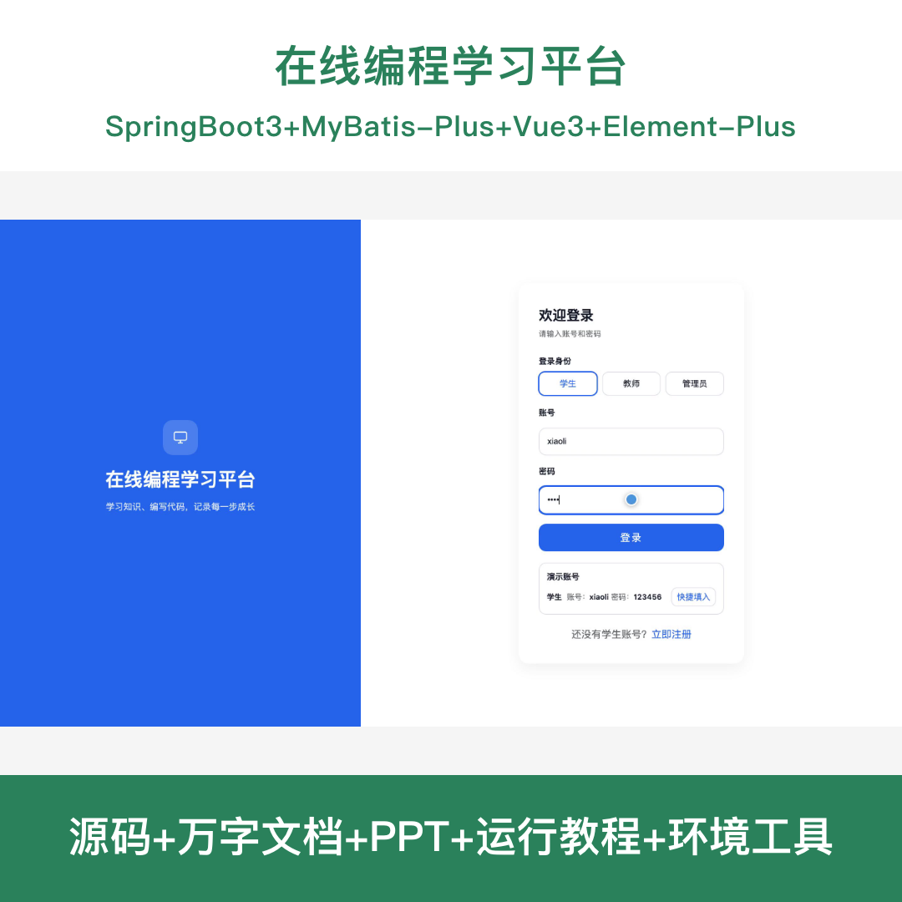
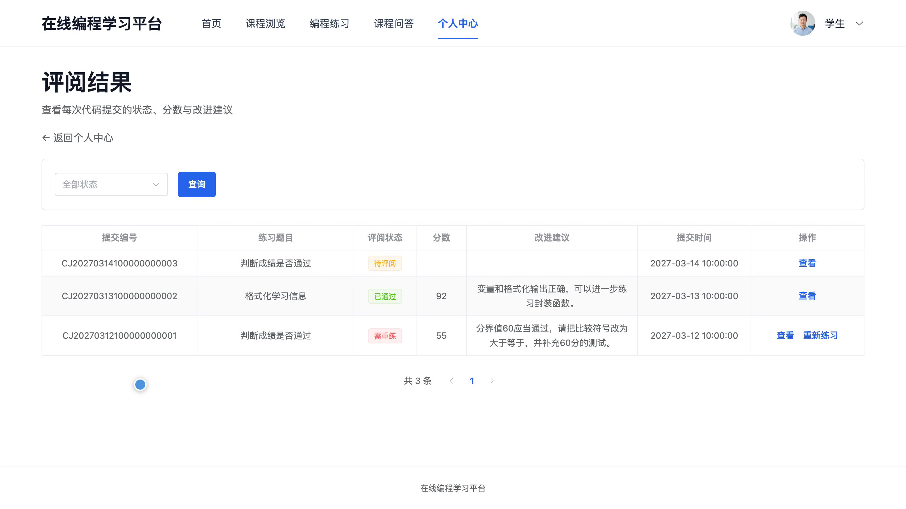
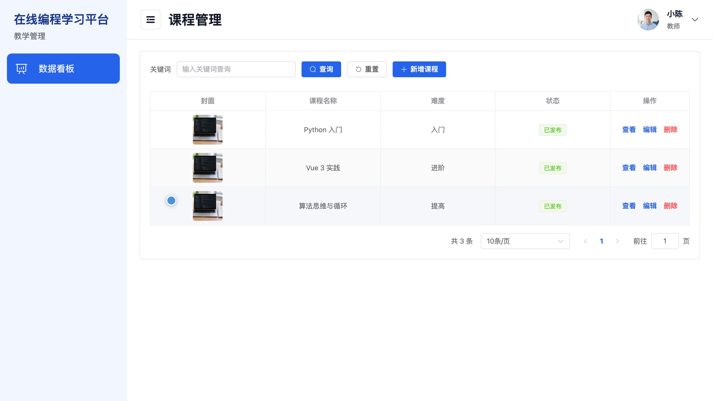
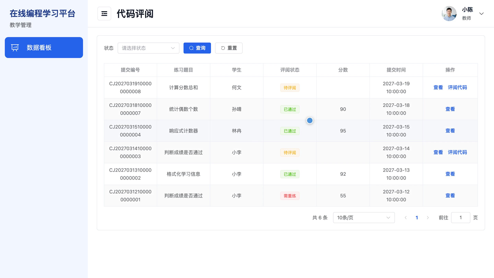
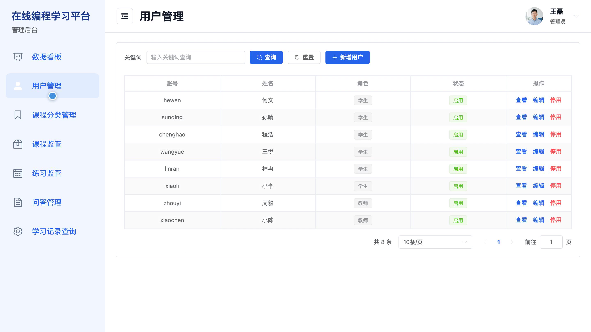
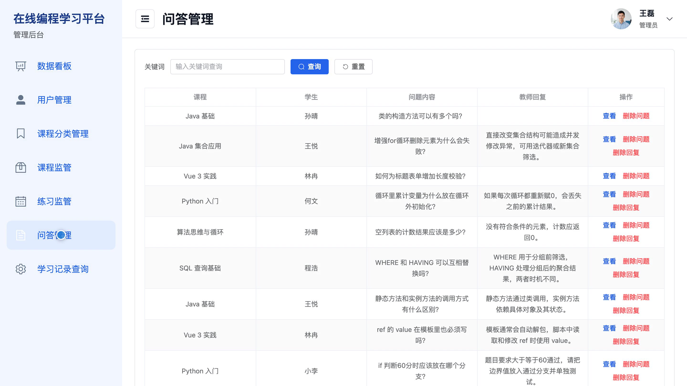

# bs157A
bs157A在线编程学习平台系统源码 Java SpringBoot3 Vue3 前后分离
## 源码问题查看主页咨询

### 一、关键词
在线编程学习、课程章节学习、编程练习、代码评阅、错题重练

### 二、作品包含
源码+数据库+全套环境和工具资源+本地部署教程

### 三、项目技术
前端技术： Html、Css、Js、Vue3.4、Element-Plus
后端技术：Java、SpringBoot3.2.0、MyBatis-Plus

### 四、运行环境要求
开发工具：IDEA/eclipse + VSCODE

数据库：MySQL5.7（共10张表）

数据库管理工具：Navicat10以上版本

环境配置软件： JDK17 + Maven3.6

前端Nodejs：20

浏览器：谷歌浏览器

### 五、项目介绍
项目编号：bs157A

在线编程学习平台面向学生、教师和管理员。学生可浏览课程与章节、提交编程练习并查看评阅结果，教师维护课程及练习并评阅代码，管理员管理账号、课程分类并监管平台内容。平台还提供课程问答、学习进度和错题重练功能。

角色：学生、教师、管理员

学生功能：学生注册登录、课程筛选与收藏、章节学习与进度记录、在线编程练习及代码提交、评阅结果查看、错题重练、课程问答、学习看板及个人资料维护。

教师功能：教师账号登录、本人课程与章节管理、练习题目及评分标准维护、代码提交评阅、课程问答回复、学生学习统计、个人资料维护。

管理员功能：管理员账号登录、学生与教师账号管理、课程分类管理、课程监管、练习监管、问答管理、学习记录查询、平台数据统计。

### 六、运行截图

